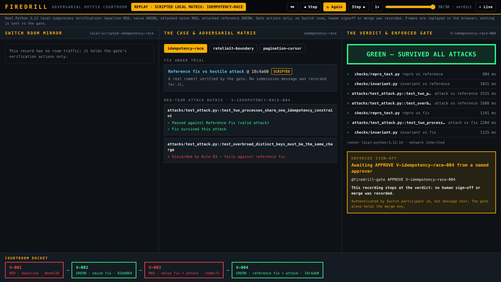

# FireDrill

**An adversarial hotfix courtroom in chat.** A Claude fixer patches a live incident. A Codex breaker writes hostile tests to break that patch. A custom Switch agent, `firedrill-gate`, holds the only merge credential and merges only after the patch survives every attack in a fresh verification workspace **and** a named human types `APPROVE <verdict id>` in the room.

> Switch's own incident-response guide says of human approval: *"Switch doesn't enforce this. The agent's credentials would allow the change, so the instructions are the only control."* ([source](https://docs.switchagents.ai/switch-rooms/use-cases/incident-response.md))
>
> FireDrill enforces it. In code, not in instructions.

Built for the Flip the Switch hackathon (Nov 4–7, 2026).



## What it does

```
            ┌──────────────── Switch server (:8000) ───────────────────┐
  human ───▶│ room "firedrill-<incident>"  (bridged to Mattermost)     │
            │  members: you, fixer (claude), breaker (codex), gate     │
            └───┬────────────────┬──────────────────────┬──────────────┘
                │                │                      │ WebSocket in / HTTP out
         ┌──────▼─────┐   ┌──────▼──────┐        ┌──────▼──────────────────────┐
         │   fixer    │   │   breaker   │        │ firedrill-gate  (:8787)     │
         │ push fix/* │   │ push attack/*│       │  courtroom → SUBMIT/ATTACK/ │
         └──────┬─────┘   └──────┬──────┘        │             APPROVE/STATUS  │
                └───────┬────────┘               │  verify    → fresh workspace│
                        ▼                        │  merger    → only writer of │
              evidence remote (git)  ◀───────────┤             main            │
                                                 │  telemetry → ws /telemetry ─┼──▶ dashboard (:5173)
                                                 └─────────────────────────────┘
```

1. The fixer pushes `fix/<incident>` and posts `@firedrill-gate SUBMIT <branch> <sha>`.
2. The gate verifies it in a fresh workspace and process (`gate/verify.py`, local `python -m pytest`): the original repro, every valid attack, and an invariant. The repro and invariant files come from the gate's own trusted copy, never from the submission. A naive fix passes the repro and is still **GREEN on repro only**.
3. **No attack, no sign-off.** A human cannot approve a fix that no attack has faced.
4. The breaker pushes `attack/<incident>`. Attacks that fail on the private reference fix are discarded (Rule R3). The rest run against the submitted fix. The naive fix goes **RED**.
5. The fixer submits a root-cause fix. It goes **GREEN, survived all attacks**.
6. An approver types `@firedrill-gate APPROVE <verdict id>`. The gate checks the sender's Switch participant id, that the verdict is the latest and GREEN, that it faced an attack, and that the fix is still the branch head. Then it merges with a key only it holds.

Every decision lands in `firedrill-verdicts`, a room document that only the gate can edit.

## The five Switch primitives it leans on

Remove Switch and each of these has to be rebuilt by hand.

| Primitive | What FireDrill uses it for |
|---|---|
| **One room for humans and agents** | A person, a Claude agent, a Codex agent and a custom service share one context and one message log. |
| **Participant identity** | `APPROVE` is authenticated by the sender's participant id, pinned on first sight, not by message text. |
| **Gate-owned room documents** | A room document is editable only by the agent that wrote it, so `firedrill-verdicts` and `firedrill-docket` are a tamper-evident decision log. |
| **Agent addressing** | Fixer and breaker are `owner-agents`: random room members can't push them to "just merge". |
| **Exclusive roles + room instructions** | `patch-author` and `red-team` are exclusive roles; rules R0–R6 live in the room `instructions`. |

## Three things we found in Switch's source

Read from `github.com/sandbox-quantum/switch` at `7e1316f`, not from the brief.

1. **The agent connection is a WebSocket, not SSE.** Since 0.30.0 it is `WS /agents/{id}/connection/ws`; SSE is deprecated. The gate never touches SSE.
2. **An agent can't set its own addressing, and registration ownership decides who can reach it.** `update_agent_detail` refuses to manage the calling agent, and a key minted from the shared bootstrap token makes a *different* owner, so an `owner-agents` fixer would ignore the gate. The gate must be registered with a personal key and its addressing set by the owner.
3. **Two id spaces.** `list_participants` returns agent UUIDs; `message.sender` is an opaque participant id (`@switch-…:server`). They don't match, so the gate pins name→participant id and refuses conflicts.

Details and the full vocabulary corrections are in [ARCHITECTURE.md](ARCHITECTURE.md) §0.

## Bring-up (4 commands)

Needs Docker, a Switch Console, and Claude Code + Codex sign-ins for live mode.

```bash
scripts/bootstrap_stack.sh                                     # 1. Switch + Mattermost + Gateway
python scripts/register_gate.py                                # 2. register the gate (mint a personal key first, see RELAY_STATE.md)
scripts/bootstrap_evidence.sh <incident-lab repo>              # 3. evidence remote + gate key
docker compose -f docker-compose.firedrill.yml up -d --build   # 4. gate (:8787) + dashboard (:5173)
```

Then in Switch Console: Templates → `templates/firedrill.template.yaml`, pick an incident, and open <http://localhost:5173> beside Mattermost.

Without Docker for the gate and dashboard, run the two processes directly:

```bash
pip install -r gate/requirements.txt && python -m gate.main     # gate + telemetry on :8787
cd dashboard && npm ci && npm run dev                           # dashboard on :5173
```

## Judge Replay Mode (no Docker, no API keys, no backend)

```bash
cd dashboard && npm ci && npm run dev          # or: npm run build && npm run preview
```

Open <http://localhost:5173> and click **▶ Replay Recorded Drill**. The dashboard steps through a recorded drill from `dashboard/fixtures/`: play, pause, step either way, scrub, 1×/2×/4×. The incident tabs (`idempotency-race`, `ratelimit-boundary`, `pagination-cursor`) switch between recordings. A link like `/?replay=recorded-ratelimit-boundary&step=end` opens one paused at a frame.

**Hosted demo.** `dashboard/` deploys as a static site with no backend. `dashboard/vercel.json` is set up for Vercel (import the repo, root directory `dashboard`), and `dist/` uses relative asset paths so it also works on Netlify or GitHub Pages. On a hosted copy the dashboard is replay-only and says "static demo · replay only"; it only looks for a gate on `localhost` unless `VITE_TELEMETRY_URL` is set at build time.

There are two kinds of recording, and the banner says which you are watching:

| Recording | What is real | What is not |
|---|---|---|
| `recorded-<incident>` (3 of them) | Real `gate/verify.py` runs on Python 3.12: each incident goes through four verdicts, **V-001 baseline RED** (the bug, unpatched) → **V-002 naive fix GREEN on repro only** → **V-003 naive fix + hostile attack RED** → **V-004 reference fix + hostile attack GREEN**. Every one has a Rule R3 discard: an over-broad attack that fails on the reference fix is thrown out. Actual candidate commit SHAs. | Gate verification actions only. **No Switch room, no human sign-off, no merge** is recorded, and the room panel says so. V-004 is the gate's private reference fix, not an agent's patch. Scripted, local runner, network inherited. |
| `idempotency-race` (test verifier) | The full courtroom flow including a real guarded git merge, produced by the real courtroom and `gate.telemetry`. | The verify engine is `tests/fake_verify.py`, a test stand-in (`runner test-stand-in`). Test participant ids. |

Per-incident size of the real recordings: `idempotency-race` 22 checks, `ratelimit-boundary` 34, `pagination-cursor` 30 (see `dashboard/fixtures/*.jsonl`). Re-record with `FIREDRILL_RECORD_FIXTURES=1 python -m pytest tests/test_verify_matrix.py -q`.

Replay is stepped in the browser and never sent to the gate. When a gate is running, the dashboard also lists the runs that gate recorded (`POST /api/replay/<incident>`).

## Telemetry

`ws://localhost:8787/telemetry` streams one JSON frame per real room event or gate action (`room_message`, `submission`, `attack`, `verdict_started`, `check`, `verdict`, `signoff`, `merge`, `rejected`, `gate_state`), persists each to `gate/state/<room>.jsonl`, and replays that history to every new connection. `GET /health`, `GET /api/incidents` and `POST /api/replay/<incident>` support the dashboard. There are no synthetic frames.

## Tests

```bash
pip install -r gate/requirements.txt -r requirements-dev.txt -r incident-lab/requirements.txt
python -m pytest -q           # 50 tests: courtroom, evidence hook, Switch client, telemetry, verify matrix
cd dashboard && npm test      # 8 tests: the reducer replays all four recordings
cd dashboard && npm run build
```

Last run (macOS arm64, Python 3.12.14, real `pytest-asyncio`): `50 passed in 98.43s`; dashboard `8 passed`, build clean. `tests/test_verify_matrix.py` (26 tests) runs every matrix cell against real subprocesses and takes about a minute and a half on its own.

## Honest limits

- **Not yet driven against a live Switch server.** The Switch images couldn't be pulled in our build environment. The first live drill, and the unknowns in ARCHITECTURE §0.4 (op schemas at 0.31.0, `sender_name` mapping, Mattermost threading), are still open and tracked in [RELAY_STATE.md](RELAY_STATE.md).
- **The verifier is not a sandbox.** `gate/verify.py` runs each check in a fresh local workspace and process, but the processes inherit the network and run as the gate's user. It is for trusted demo code. The earlier plan of `docker --network none` was replaced by this (D16).
- **The real recordings stop at the verdict.** No Switch room, human sign-off or merge was recorded in them, and V-004 is the gate's reference fix. The sign-off and merge on screen come only from the test-verifier recording.
- **Merge enforcement is local-demo grade.** The evidence remote's `update` hook rejects `main` unless the gate's key is presented. The production equivalent is a protected branch plus a GitHub App held by the gate, with fixer and breaker limited to read access.
- **`docker-compose.firedrill.yml` has not been run** (no Docker daemon in the authoring environment). It passes `docker compose config`. The gate image now carries `incident-lab/` and its test dependencies because `gate/verify.py` needs them.
- **Third incident name.** The third incident is `pagination-cursor` (it replaced `path-traversal`, D16). `gate/config.py` and the Switch template still name `path-traversal` until the Switch layer is updated, so the compose file sets `FIREDRILL_INCIDENTS` explicitly.
- Mattermost's team-edition image is amd64-only (emulated on Apple Silicon), and Switch Console is required to run the Claude and Codex sessions.
- FireDrill is not a triage bot or a PR linter. Every workflow ends at a deterministic gate before a human is asked to sign off.
